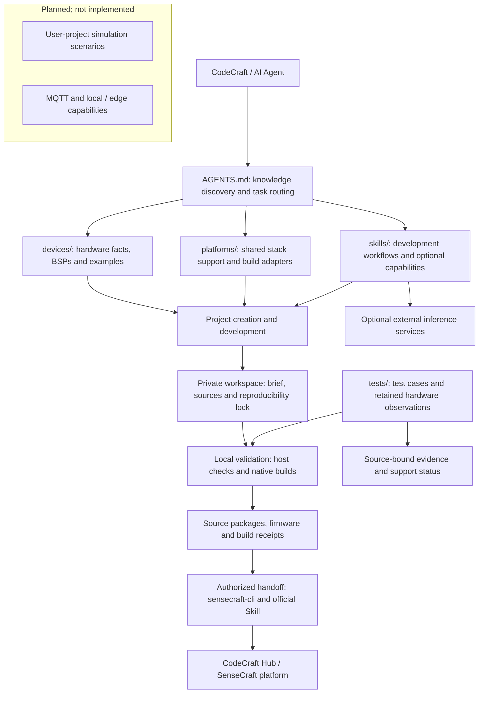

# CodeCraft hardware repository architecture plan

Status: locally maintained design and implementation alignment, updated 2026-11-26.

Adapted and translated from [CodeCraft hardware architecture V0.2](https://seeedstudio.feishu.cn/docx/QgNjdqDbwotGQcxDKHmcxYMvn6b),
authored by Gao Shihan and Que Herong, dated 2026-11-18; retrieved document
revision 1566. This is an updated Markdown adaptation, not a verbatim archive.
The original logical whiteboard is replaced by the editable Mermaid diagram below.
No login parameters or personal mention identifiers are retained.

Maintain subsequent design changes here first. The Feishu document has not been
updated. This plan does not override the [repository contract](../../AGENTS.md)
or duplicate canonical device specifications. The [implementation overview](overview.md)
describes ownership in detail; the [alignment TODO](../development/architecture-alignment-todo.md)
tracks differences and acceptance. Current implementation baseline: local commit
`f537718` on `feat/v0.5/rust-creator-cli`; this is not a claim of upstream publication.

## 1. Purpose and external relationships

The repository organizes hardware knowledge, BSPs, examples and development
workflows so an AI Agent can discover devices, clarify requirements, create a
project and validate its software. CodeCraft is a consumer, not implemented here.
CodeCraft Hub is the external application publishing and distribution platform.
The external SenseCraft CLI owns platform authentication and authorized platform
operations; this repository owns hardware facts and local development.

The normal flow is knowledge discovery, project authoring, local validation,
then an explicitly requested platform handoff. Platform success does not establish
hardware compatibility. Ordinary authoring does not require a cloud account.

## 2. Architecture

### 2.1 Current logical architecture

Solid arrows show implemented ownership and invocation. The separate planned
subgraph is not part of the current executable discovery or verification flow.

Repository tooling supports discovery, project creation, reproducibility and
validation. Tool implementation and installation details are documented in the
[tooling guide](../development/rust-cli.md). Native SDK prerequisites apply when
building for the selected platform; ordinary authoring does not require SDK setup.

### 2.2 Physical ownership

| Entry | Current responsibility |
| --- | --- |
| README.md and README.zh_CN.md | Human introduction, quick start and navigation |
| AGENTS.md | Authored repository contract and task routing; not generated |
| CONTRIBUTION.md | Navigation to contribution rules, not another rule owner |
| devices/AGENTS.md | Generated device directory |
| devices/<device>/AGENTS.md | Authored, sourced hardware facts and acceptance procedures |
| devices/<device>/reference/ | Supporting references and implementation guidance |
| devices/<device>/targets/ | Target manifest, native BSP, examples and board configuration |
| platforms/<stack>/ | Shared stack adapters, components and build helpers |
| skills/ | Flat development workflows and standalone cloud clients |
| tools/cli/ | Project workflows, repository checks and package maintenance |
| tools/skill_packages/ | Package maintenance, provenance and release records |
| tests/ | All maintained tests, fixtures, mocks and retained hardware evidence |
| projects/<name>/ | Ignored private applications; external output directories also work |
| docs/ and .github/ | Guidance, plans, workflows and generated CI inventory |

There is no registered simulators directory or top-level capabilities directory.
Do not create placeholders merely to match a diagram. Linux Targets retain native
overlays and demos; other stacks retain their native conventions.

### 2.3 Core boundaries

Maintain facts at their owning source and reference or generate other views.
Use task-specific navigation instead of requiring an AGENTS index in every folder.
Context and exports follow explicit dependency closures; missing declared files
are errors, while unknown hardware facts remain unknown.

Creator profiles, locks and source graphs use schema 4. Target manifests remain
schema 3, Platform metadata schema 3 and parsed Device documents schema 5. Historical evidence keeps its original record schema. These version numbers describe
different contracts, not one global version.

## 3. Directory requirements

### Agent entry and generated indexes

Root AGENTS routes to relevant owners; it is not a generated full inventory.
Device indexes, native interface views, Skill inventory and CI matrices have
producers. Regenerate those outputs instead of editing them by hand. Authored
Device documents remain unchanged by generation.

### Devices and hardware facts

Device entries own overview, physical layout, typed specifications, limitations,
sources and acceptance procedures. Reference guides explain implementations;
Target manifests bind actual native interfaces and examples. Dated observations,
records and logs belong under tests/devices/<device>/.

The original proposal allowed inapplicable modules to be omitted and placed media
links in reference/image-generation.md. The current parser requires fixed sections
and permits an optional Assets section. This difference is tracked for a focused
schema review; this plan does not silently change the parser contract. Follow the
[current Device format](../development/device-documents.md) until that review lands.
Asset sources and rights must be attributable; absent material remains unknown.

### Platforms

ESP-IDF, Arduino and Linux supply their own native conventions and toolchains.
Board implementations stay in devices/<device>/targets/. Platform-owned native.rs
implements native operations; static and evidence checks reuse platform-owned contracts.
Shared tooling must not reimplement native operations by branching on stack IDs.

### Simulators: planned

The source proposal names Wio Terminal, reTerminal Sticky and SenseCAP Indicator
simulators as candidates. None is registered. The first milestone should select
one actual user-project scenario, reuse production logic, declare coverage and
limitations, and emit structured results. Host tests are not a substitute for
that simulator, and simulation cannot prove electrical or physical behavior.

### Skills

Development workflows cover ideation, discovery, setup, development, build,
validation, device testing and debugging. The standalone reCamera SDK Skill does
not establish a registered reCamera Device/Target.

Current cloud packages provide LLM, ASR, TTS and image generation. Each owns its
contract, API reference and package-local client. Native-only projects exclude
these packages; explicit selection adds a complete pinned package. MQTT and
local/edge providers remain future work, not available bindings.

The external SenseCraft CLI handles platform resources and account authentication.
The verified integration does not replace the existing inference APIs. Device
quotas and endpoint availability are external service policy, not repository
constants. See [external-tool routing](../development/sensecraft-cli.md).

### Private projects and publishing handoff

project.yaml owns purpose, users, scenarios and BOM. Creation and relocking render
a marked AGENTS region and preserve custom rules outside it. Projects may live
under ignored projects/<name> or an explicit external path; platform handoff does
not require a shared repository working directory.

Create and inspect projects without probing an SDK. Before native builds, activate
the declared SDK and capture it with lock-project --toolchain. Source-only changes
require relocking, not recompiling the CLI. Locks preserve original import identity
separately from reviewed application changes and bind the compiled CLI identity.

Publishing uses the external CLI's official bundled create-app Skill under explicit
authorization. There is no skills/_shared/sensecraft wrapper in this repository.

## 4. Device coverage and roadmap

The original ten-device scope is represented by seven ESP-IDF Targets, two Arduino
Targets and one Linux Target. The [generated device directory](../../devices/AGENTS.md)
and [native interface inventory](../inventory.md) own the current list; do not
copy SKU tables into this plan. Registration does not imply every peripheral,
marketed model or hardware revision is verified. Inspect each Device's limitations,
selected variant and source-bound observations before claiming support.

reCamera 2002/2002w, reCamera Pro and XIAO Pocket remain roadmap candidates from
the source proposal. A standalone SDK Skill is not native Target onboarding.

## 5. Maintenance and contribution

Follow [CONTRIBUTION.md](../../CONTRIBUTION.md) and the root contribution contract.
Identify the change owner and sources, change only the relevant layer, regenerate
owned views and report actual results. Documentation-only changes require static
checks, not firmware compilation. Native checks follow actual build impact;
a new commit or knowledge digest alone is not a reason to rebuild firmware.

Rules should have a concrete consumer and apply only to their relevant task.
Do not add empty directories, duplicate inventories or blanket approval gates.
Physical writes and platform publication remain separately authorized operations.

## 6. Evidence and acceptance

Builds, exported-project checks, simulation and physical observations are distinct.
Records preserve source identity, expected cases, environment/toolchain, logs,
limitations and attribution. Hardware observations apply only to their declared
revision and tested behavior. Historical records must not be rewritten as fresh.

Project context reads source-bound evidence using the current source graph and
compiled tool identity. Historical record schema 2 is archived without promotion.
New record schema 3 binds graph schema 4, toolchain, complete cases and hashed logs.
Physical promotion additionally keeps variant and observed revision distinct;
observations from different revisions cannot be combined into a passing device.
See [evidence compatibility](../development/rust-cli.md#evidence-compatibility).

| Original milestone | Current assessment |
| --- | --- |
| Device facts and indexes | Implemented; root rules remain authored |
| Context and discovery | Device/Target/Skill workflows implemented; simulator discovery absent |
| Platforms and reproducible projects | Three stacks and schema 4 project lifecycle implemented |
| MQTT and ASR pilot, then local/edge | ASR exists; MQTT and local/edge remain pending |
| Simulator verification loop | Pending first registered simulator |
| Creation and publishing loop | Local artifacts and external routing exist; no claim of live platform E2E acceptance |
| Source-bound support status | Current graph/CLI-bound evidence is integrated; historical records stay archival |

The [alignment TODO](../development/architecture-alignment-todo.md) defines the
next work. Neither this document nor a successful software check promotes physical
support or authorizes publication.
