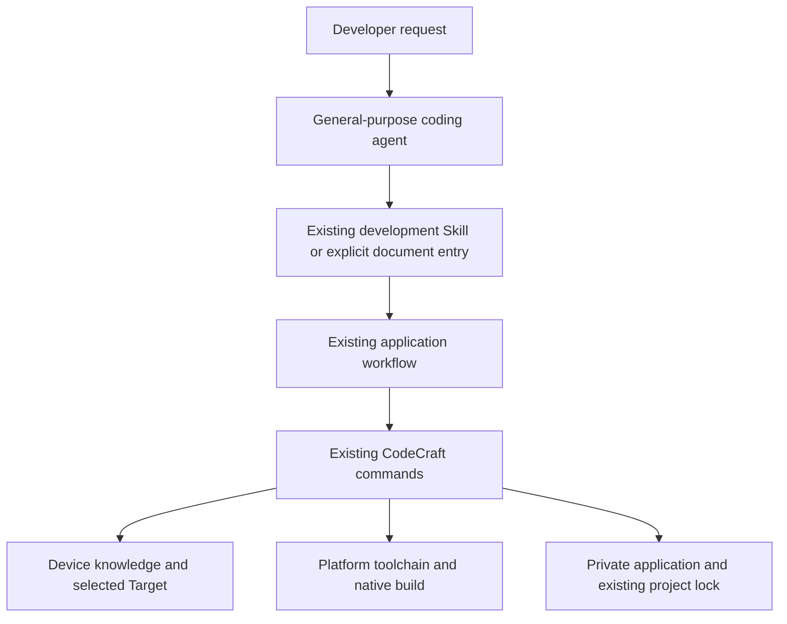

# Agent client compatibility without architecture changes

Status: unified entry guidance implemented in the working tree; not a new release.
Date: 2026-11-26.

## Objective and decision

Help developers use a general-purpose coding agent to choose a supported device,
create a private application, implement features and run appropriate checks.
Support multiple clients by improving the existing Skill entry and documenting
how each client discovers it. Do not introduce a new architecture to achieve this.

The user's explicit constraint is to avoid major architecture changes. This
document scopes small, independently reviewable changes within existing owners.
The implementation below follows the user's request. It does not install into
user profiles, change client settings, commit, publish or write devices.

## Implemented guidance

- The existing [develop Skill](../../skills/codecraft-development-develop/SKILL.md)
  is the application entry, with conditional routing rather than a new Skill.
- All eight native development workflow Skills identify the selected workspace
  separately from their installation location.
- The existing [portable workflow](application-workflow.md#workspace-entry-and-routing)
  owns workspace resolution and continued work on an existing project.
- The [shared setup guide](agent-client-setup.md) supplies native-Skill,
  project-rule and explicit-document entry through the same reusable request.
- Root, Skill and documentation README pairs expose the common entry. No
  client-specific configuration file or runtime adapter is added.

Client experience testing remains with users. Future user feedback can refine
these shared instructions without requiring a client-specific workflow branch.

## Existing baseline

The [architecture](../architecture/overview.md) remains authoritative:

| Existing owner | Responsibility retained |
| --- | --- |
| devices/<device>/ | Authored hardware knowledge, native Targets, BSPs and examples |
| platforms/<stack>/ | Software-stack adaptation, toolchain probes and native commands |
| skills/ | Flat development workflows and independent cloud capability packages |
| tools/cli/ | Existing public CLI, discovery, context, export, locks and orchestration |
| tools/skill_packages/ | Existing package maintenance and provenance, when applicable |
| projects/ or an explicit external directory | Developer-owned private applications |
| tests/ | Owner-scoped tests and separately retained device evidence |

The existing development Skills already cover ideation, discovery, development,
setup, builds, diagnosis, validation and authorized device operations. The
[portable application workflow](application-workflow.md) connects these tasks.
Use these sources rather than creating a parallel workflow language.

The published v0.5.0 CLI is the release baseline. The current working tree also
contains onboarding changes: latest-release installation, task routing and a
read-only doctor command. Those changes are not a new published release, and
v0.5.0 does not contain doctor. Follow [CLI availability](rust-cli.md) and inspect
installed help before relying on a command.

## Scope boundary

Permitted first-stage design changes:

- Clarify descriptions and task routing in existing development SKILL.md files.
- Improve existing application-workflow.md guidance and document client setup.
- Add a small client-specific discovery/reference snippet only where the client's
  documented entry format requires one; point it at the existing workflow and
  selected workspace.
- Leave client-specific usage testing to users; do not add a compatibility
  certification process or per-client test gates.

Excluded from this design:

- New top-level directories, a workflow engine, a client-adapter runtime, a
  universal plugin system, a new service or a mandatory MCP server.
- Moving Device, Platform, Skill or CLI responsibilities; duplicating board
  catalogs, native build commands or application templates for each client.
- Changing Target, Platform, Device, profile, lock or evidence schemas.
- Replacing project.yaml, changing provenance/lock review, or storing essential
  project state exclusively in client chat history or memory.
- A mandatory subagent topology, hooks, dynamic prompt execution or a particular
  client's internal tool names.
- Removing existing required Skill availability rules. The current five-Skill
  requirement remains applicable; a simpler user-facing entry does not remove it.
- Rewriting installers, introducing package generation or modifying firmware as
  a prerequisite for documenting compatibility.

If a future request needs an excluded change, describe it separately rather
than expanding this compatibility work implicitly.

## User-facing entry and task routing

Use codecraft-development-develop as the primary application entry. Do not add a
second broad Skill competing for the same application requests. Existing narrow
Skills remain directly usable for requests such as building or debugging.

| User situation | Entry behavior |
| --- | --- |
| Existing application | Read its project guidance and continue from its selected Target and current files |
| Device already chosen | Preserve that choice, obtain its context and choose a relevant existing example |
| Device not chosen | Discover actual candidates and compare sourced constraints; ask only for information that changes selection |
| Environment unavailable | Read setup guidance; inspect or activate the intended toolchain within task authorization |
| Build requested or native code changed | Use the application's build path or scoped repository validation as appropriate |
| Build failed | Read the error and relevant debug guidance; preserve logs and diagnose before retrying |
| Device operation requested | Use existing device-test guidance and the already applicable target/port authorization |

This is conditional routing, not a mandatory sequence for every request. A small
edit to an existing application should not restart device selection, ideation or
toolchain installation. Existing authorization remains valid within its scope.

SKILL.md contains the task boundary, essential decisions and relevant pointers.
Read detailed references only when needed. Hardware knowledge stays in the
selected Device entry, and native procedures stay with the selected Platform.
Skill-to-Skill references are reading/routing instructions; they are not a
cross-client function-call protocol or a guarantee that another Skill is installed.

## Access through different clients

Use the access method available in the user's client:

| Method | Requirement | Minimal implementation |
| --- | --- | --- |
| Native Skill discovery | Client can discover and read the standard Skill package | Install existing packages using the client's supported mechanism |
| Project rule reference | Client can load a project rule and follow file references | A short reference to the existing Skill/workflow and workspace root |
| Explicit document instruction | Agent can read user-selected local files | Ask the agent to read the existing development Skill and application workflow |

These methods reach the same content and commands. They are not separate
implementations. Start with documentation; add a setup helper only after a real,
repeated installation problem justifies it. Any such helper belongs to existing
tooling and must preserve unrelated user rules and configuration.

Client-specific metadata may describe discovery or presentation. It must not
copy hardware facts, introduce a second build procedure or broaden permissions.
Codex metadata and Claude-specific extensions are optional enhancements, not
requirements for the common workflow. Do not assume equivalent extensions in
Cursor, ZCode, WorkBuddy, Muse or another client.

The diagram shows access to existing components, not new runtime layers.

## Workspace and reference resolution

A Skill installation directory is not the hardware repository or application
root. Identify the selected workspace explicitly and pass --root where needed.
Do not infer a checkout from the location of a client's personal skills folder.

Some current development Skill links use ../../docs or other repository-relative
paths. These resolve inside a checkout/export but do not establish that copying
one Skill directory is sufficient. First-stage guidance must state the required
checkout or exported workspace and resolve its existing documents there.

Keep guidance usable in both repositories and exported applications. If a client
cannot resolve external workspace references, use the explicit document entry
and record the limitation. Do not silently copy hardware sources into a Skill,
add a forwarding tree, or describe the installation as self-contained.

Retain one maintained source for shared guidance. AGENTS.md remains the project
contract; a CLAUDE.md or other client entry can reference it without
duplicating its rules. Client-specific entries are loaded according to that
client's actual behavior; do not assume automatic recursive rule loading.

## Intended clients and common capabilities

The unified design covers Codex, Claude Code, Cursor, ZCode, WorkBuddy, Muse
and other general-purpose agents able to use the access methods above. These
names identify the intended audience, not separate workflow implementations.
There is no per-client test-status table or certification requirement.

| Available client capability | Applicable workflow |
| --- | --- |
| Read workflow/project files | Guidance access and project understanding |
| Edit project files | Application authoring |
| Execute local commands in the intended environment | CLI and native build execution when prerequisites exist |
| Access the actual device/port | Authorized device operations, separately observed and recorded |

The workflow uses available capabilities rather than branching on client names.
Remote execution does not imply access to the developer's SDK, serial ports or
USB devices. A client without a terminal may assist authoring but cannot claim a
local build passed. These operational boundaries apply equally to all clients.

## Incremental implementation

| Step | Small change | Design outcome |
| --- | --- | --- |
| 1 | Refine existing develop/setup/build/debug routing | Existing projects do not repeat selection; application work avoids repository maintenance gates |
| 2 | Document workspace discovery and external reference resolution | Guidance locates existing sources without depending on installation-directory ancestry |
| 3 | Describe native Skill, project-rule and explicit-document entry | All entry methods lead to the same workflow and commands |
| 4 | Add only necessary client setup snippets | No duplicated workflow, overwritten custom rules or new runtime dependency |
| 5 | Incorporate user feedback into the common guidance | Fix demonstrated issues without creating a separate workflow for each client |

Design for ordinary user situations: a new application without a selected board,
a new application with a selected board, an existing-project feature change, a
missing toolchain and a build failure. A request to edit an application does not
authorize device writes, cloud publication or unrelated repository changes.
Switching clients should resume from project files without requiring the previous
chat transcript.

Client-specific installation and end-to-end experience testing are left to users.
They are not prerequisites for completing this design or delivering the shared
workflow. Users may optionally report their client/version, environment, task
and concrete issue to help reproduce a problem. Do not require a test report,
compatibility matrix entry or performance benchmark before they can use the Skill.
Do not claim measured speedups without measurements.

Repository contributions still follow the existing
[validation scope](../../AGENTS.md#required-validation-and-delivery) and
[test ownership](testing.md). These are checks on repository changes, not a new
client certification gate. Document-only changes do not require native builds.
During actual application development, retain the normal build-result reporting
and device-evidence boundaries; leaving client testing to users does not turn an
unexecuted firmware build or device operation into a successful result.

## Rollback and completion boundary

Each change should be reversible as a Skill, documentation or client-entry change.
An existing application must remain usable with its original native workflow and
lock. No migration of hardware data or private projects is part of this proposal.

Delivery consists of common workflow guidance and the minimal entry instructions
needed to use it. It does not depend on completing a client-by-client test campaign.
Adding entry instructions does not authorize changing the repository architecture
or relaxing hardware evidence and source ownership requirements.

## Format references

Reviewed on 2026-11-26. These inform the shared format and optional entry metadata:

- [Agent Skills specification](https://agentskills.io/specification): common
  SKILL.md structure and progressive disclosure.
- [OpenAI Skill guidance](https://developers.openai.com/plugins/build/skills):
  focused instructions, supporting references and optional client metadata.
- [Claude Code Skills](https://code.claude.com/docs/en/skills): standard Skill
  support and client-specific extensions.

Consult the exact product's authoritative documentation before adding Cursor,
ZCode, WorkBuddy, Muse or other installation instructions. Keep product-specific
paths and entry metadata separate from the shared workflow; users validate the
experience in their own environments.
